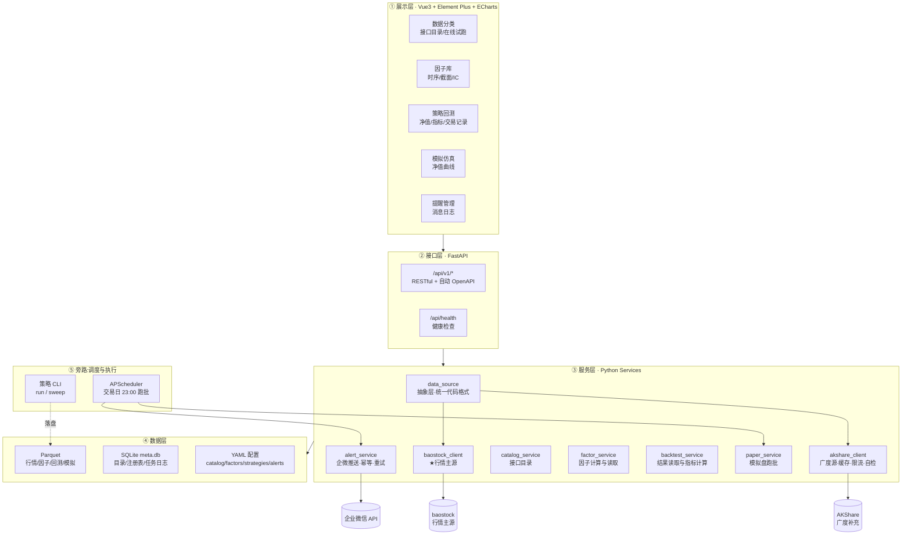

# A股投资本地服务 · 技术架构设计

> 版本 **v1.11** ｜ 2026-09-22
> 数据源：**baostock（行情主源）+ AKShare（广度补充）**
> 定位：单机/内网自用系统，先跑通"看得见数据"，再逐步长成"能交易决策"
> **配套文档**：`策略规格说明书.md`（v1.2，已冻结）｜`docs/开发进度.md`（进度与交接）
> ｜`docs/技术架构-详细设计.md`（详细设计：数据层/模块/API/决策记录）
> ｜`docs/回测与策略研究.md`（回测诊断/因子分析/策略表现）

**v1.11 变更（2026-09-22）**
- 📄 **第 4 章「工程目录结构」重写**：改为**文件级**注释，覆盖 `backend/` `data/` `frontend/`
  三个目录（每个文件是干什么的都写清楚），并补上 `backend/config/`、`backend/tools/`、
  `backend/sql/`、`deploy/`、`docs/` 等此前缺失的部分。
  ⚠️ 旧版写着的 `catalog/`（顶层）、`data/raw/quote_min/`、`frontend/src/views/factors/FactorView.vue`
  等**早已不存在**（或路径不对）—— 本轮按实际目录逐文件核对。
- 🔧 **`data/` 维度一览补全**：8 个财务数据集、逐日股票池快照、因子产物、回测/寻优/模拟盘
  落盘结构逐个标注落盘者与列契约。
- ⭐ **新增「本地数据」页**（模块 1 · 数据分类的第 4 个标签页）：以**磁盘**为唯一真相，
  展示本地 20 个数据维度的规模 + 每个维度 20 行真实示例；实现见
  `backend/app/services/local_data_service.py`。

**v1.10 变更（2026-09-22）**
- 🔧 **换机迁移加固**：项目目录整体拷到新机器后无法启动，根因是启动脚本引用了
  上一台机器的用户目录下的 Python。本轮把**运行环境收进项目内**（`backend/.venv`）
  并重写启动脚本 —— 三个 `.bat` 里**不再有任何绝对路径**（见 8.5.2）。
- 🔧 **新增 `SERVE_FRONTEND` 开关**：服务模式下后端可直接托管 `frontend/dist`，
  一个进程、一个端口跑整站（此前"服务模式"声称可用 `dist`，实际没有任何进程提供它）。
- 📄 文档内所有指向旧机器的绝对路径（用户名 / 盘符 / 临时目录）改为通用写法。

**v1.9 变更（2026-09-20）**
- 📄 **文档精简重构**：① 回测/因子/策略表现的研究内容从 `docs/开发进度.md` 迁出，
  独立成档 **`docs/回测与策略研究.md`**；② 本文件删除 v1.6~v1.8 变更记录与已完成阶段的
  分阶段任务表/甘特（历史见 git log，落地细节见开发进度 §2）；③ 跑批时刻残留的 15:35 统一订正为 23:00。
- ✅ 五个模块全部落地（2026-09-20），系统进入**优化迭代阶段**。
- 历史版本变更记录（v1.1 ~ v1.5）不再罗列，见 git log。

---

## 0. 一句话结论

这套系统**不做追求大而全的量化平台**。它本质是：

> 一个 **只读的展示层**（模块1/2/3）＋ 一个 **日度跑批的调度器**（模块4/5）。
> 数据落在本地文件里，策略在本地脚本里，系统只负责**把结果画出来**和**按点推送**。

因此技术选型只有一个硬约束：**必须能直接调 akshare（Python）**。其余全部为简化服务。

---

## 1. 需求拆解与关键判断

### 1.1 五个模块的本质差异

| 模块 | 本质 | 是否需要计算 | 是否有外部依赖 | 可离线 |
|---|---|---|---|---|
| 1 数据分类 | 接口目录浏览器 + 在线试跑 | 无（转发调用） | akshare | 半 |
| 2 因子库 | 离线算好的因子 → 可视化 | 有（离线批处理） | akshare | 是 |
| 3 策略回测 | 离线跑好的结果 → 可视化 | 无（策略在系统外） | 无 | 是 |
| 4 模拟仿真 | 日度跑批 + 净值落盘 | 有（在线跑批） | akshare | 否 |
| 5 用户提醒 | 事件 → 企微推送 | 无 | 企业微信 API | 否 |

### 1.2 三个决定架构走向的判断

**判断一：模块 1 和模块 3 不需要"后端计算"，只需要"读本地文件"。**
这是最重要的一条。模块 3 你说了"策略本地先开发好，系统直接展示回测结果"——那就意味着：

- ❌ 不要在 Web 端做"点击回测"按钮，不要做参数调优界面，不要做任务队列
- ✅ 策略以 CLI 脚本运行 → 结果落盘到 `data/backtest/{strategy}/{run_id}/` → 前端只读这个目录

**收益**：前端与策略彻底解耦。你改策略不用动系统，系统挂了不影响跑策略，回测结果就是普通文件，能直接拷走/归档/做版本对比。这是最省事的架构，没有之一。

**判断二：不要引入数据库服务。**
全市场 A 股 20 年日线约 5000 只 × 5000 天 ≈ 2500 万行，Parquet 压缩后不到 1GB，DuckDB 单机扫描是亚秒级。装 PostgreSQL / ClickHouse / Redis 属于纯运维负担。**用 Parquet + DuckDB（查询）＋ SQLite（元数据）**，零运维。

**判断三：模块 2/4/5 的"先搭框架"不等于"先写空页面"。**
真正的"搭框架"是**把扩展点和契约定死**，让后面填充时不用改结构。具体做法见第 6 章：因子注册表、策略基类、消息模板、调度任务槽位——这些先落地，业务逻辑留 TODO。

### 1.3 一个必须提前定的决策点

模块 2（因子库）和模块 3（回测）**没有硬依赖关系**——你的策略是本地开发的，因子大概率在策略内部已经算好了。所以：

- 若你的策略**依赖系统侧统一计算因子** → 先做模块 2，模块 3 复用因子结果
- 若你的策略**自带因子计算逻辑**（更常见） → 先做模块 3，模块 2 作为独立的"因子研究工具"后置

**✅ 已确认（2026-09-16）：你的策略自带因子计算 → 按后者排期，先做模块 3，模块 2 作为独立的因子研究工具后置。**

---

## 2. 技术选型

### 2.1 选型总表

| 层 | 选型 | 版本 | 理由 |
|---|---|---|---|
| 语言 | Python | 3.11 ~ 3.13 | akshare 强绑定；3.13 已验证可用 |
| Web 框架 | **FastAPI** + Uvicorn | ≥0.115 | 自动生成 OpenAPI 文档；Pydantic 做参数校验；原生 async |
| 数据校验 | Pydantic + pydantic-settings | v2 | 配置与响应模型统一 |
| 数据处理 | pandas + numpy | pandas ≥2.0 | akshare 返回即 DataFrame，零转换成本 |
| 列存/查询 | **PyArrow + DuckDB** | | 直接对 Parquet 做 SQL，免入库 |
| 元数据库 | **SQLite** | 内置 | 单文件、零运维、够用 |
| 任务调度 | **APScheduler** | v3 | 进程内调度，不需要 Celery/Redis |
| HTTP 客户端 | httpx | | 调企微 API，支持超时/重试/异步 |
| 配置 | python-dotenv + YAML | | 密钥走 `.env`，业务配置走 YAML |
| 日志 | loguru | | 一行配置搞定滚动+分文件 |
| 前端框架 | **Vue 3 + Vite + TypeScript** | | 组合式 API 上手快；生态成熟 |
| UI 组件 | **Element Plus** | | 内置 `el-collapse` 直接满足"点击展开"，`el-table` 满足交易记录表 |
| 图表 | **ECharts 5** + vue-echarts | | 你已习惯；DataZoom / 多图联动 / 热力图全都现成 |
| 状态/路由 | Pinia + Vue Router | | 标准组合 |
| 包管理 | **uv**（Python）/ **npm**（前端） | | uv 比 pip 快 10 倍以上；前端原计划 pnpm，因本机未装且禁止 `npm i -g`，实际改用 npm（见附录 B.3） |
| 部署 | Docker + docker-compose | | 本地 Windows 开发 → 内网 Linux 服务器一键搬 |
| 反向代理 | Nginx | | 仅生产环境需要，前端静态 + 后端反代 |

### 2.3 版本锁定要求（重要）

`akshare` **必须锁死版本**并记录在 `requirements.txt` 中。它的接口签名和返回字段变更非常频繁（几乎每次发版都有 breaking change）。升级前必须在 staging 跑一遍启动自检脚本。

```txt
# requirements.txt 关键项
akshare==1.18.94        # 锁死，升级前先跑 tools/check_catalog.py
pandas>=2.2,<3.0
fastapi>=0.115
duckdb>=1.1
```

> ⚠️ 注意：本文档编写时实测安装，**pip 默认解析出的就是 `pandas 3.0.5`**——这不是假想风险。pandas 3.0 有若干破坏性变更（Copy-on-Write 默认开启、部分 `groupby` 行为变更等），建议显式约束在 `<3.0`，除非你确认策略代码已适配。
>
> ✅ 实测环境（2026-09-16）：`Python 3.13.12` + `akshare 1.18.94` + `numpy 2.5.3` + `pandas 3.0.5`。
> akshare 在 pandas 3.0 下**基本功能可正常运行**（交易日历、历史行情实测通过），但策略代码里若用了 pandas 2.x 的旧写法仍需注意。

---

## 3. 总体架构

### 3.1 分层视图



### 3.2 核心数据流

**读路径（模块 1/2/3）**

```
AKShare ──拉取──> Parquet ──DuckDB 查询──> Service ──JSON──> Vue 组件 ──ECharts──> 页面
                   ↑
        策略 CLI ──落盘──┘（模块3 回测结果同样走这条只读路径）
```

**写路径（模块 4/5）**

```
APScheduler(23:00) ──> paper_service 跑批 ──> 持仓/净值落盘
                                          └──> alert_service 判定事件 ──> 企业微信 ──> alert_log
```

**关键设计：读路径完全只读。** 前端任何请求都不触发计算（除了模块 1 的"试跑"按钮，它有 300s 缓存兜底）。这意味着页面响应永远是毫秒级，且服务重启不丢状态。

---

## 4. 工程目录结构

> **怎么读这条目**
>
> 1. **★ = 不可绕过的关键文件** —— 改它之前先看本节末尾的「三条硬性纪律」。
> 2. 每个目录块的第一行是**该目录的职责**；`#` 后面是「这个文件干什么」。
> 3. **文件级注释覆盖 `backend/`、`data/`、`frontend/` 三个目录**（日常改代码只会在这三处）；
>    其余目录点到文件名为止。
> 4. `data/` 下**全部是运行产物**（`.gitignore` 已忽略），仓库里只留 `.gitkeep`。
>    各维度现在到底有多少数据，看前端「数据分类 → 本地数据」页 —— 那里以**磁盘**为唯一真相。
> 5. 本节按 2026-09-22 的**实际目录**逐文件核对过。**文档与磁盘对不上是本项目踩过的坑**
>    （旧版这节还写着早已不存在的 `catalog/` 与 `quote_min/`）。

### 4.0 顶层全景

```
A股投资本地服务/
├── backend/            # 后端全部代码（Python 3.13 + FastAPI）
├── data/               # ★ 所有落盘数据（运行产物，不进 git）
├── frontend/           # 前端（Vue3 + TS + Element Plus + ECharts）
├── deploy/             # 部署（Docker + nginx）
├── docs/               # 文档（详细设计 / 开发进度 / 研究结论 / 梳理建议）
├── backend/.venv/      # ★ 项目内虚拟环境（setup.bat 生成，随目录走，换机不失效）
├── _env.bat            # 环境探测：解释器优先级 = backend\.venv → %PYTHON% → PATH
├── setup.bat           # 一键建环境（建 venv + 装依赖 + 装 node_modules；幂等）
├── start-dev.bat       # 开发启动：后端 :8000 + 前端 Vite :5173（两个窗口）
├── start-service.bat   # 服务启动：单端口 :8000 跑整站（后端托管 frontend/dist）
├── requirements.txt    # 依赖清单（锁版本，见 §2.3）
├── .env / .env.example # 密钥与开关（SERVE_FRONTEND / DATA_ROOT / 企微 webhook 等）
├── .gitignore / .gitattributes
├── README.md           # 快速上手 + 常见问题
├── 技术架构.md          # ★ 本文件（主线）
└── 策略规格说明书.md     # ★ 策略规则的唯一依据（改策略先改它并升版本）
```

---

### 4.1 `backend/` —— 后端

```
backend/
├── app/                        # ★ FastAPI 应用（Web 层；计算密集的东西不在这里跑）
│   ├── main.py                 # ★ 入口：注册路由/中间件、启动自检、启动补跑（后台线程）、SPA 托管
│   ├── core/                   # 底座：配置、路径、日志、异常、JSON 净化
│   │   ├── config.py           # .env（密钥）+ config.yaml（业务）合并成一个 Settings 对象
│   │   ├── paths.py            # ★ 统一路径常量；全项目禁止硬编码路径
│   │   ├── logging.py          # loguru 配置（按日期分目录写 logs/）
│   │   ├── errors.py           # 统一异常与错误码（AppError 体系 + 中文 message）
│   │   └── jsonutils.py        # 把 NaN/Infinity 换成 None、numpy 标量换成原生类型
│   ├── api/v1/                 # ★ HTTP 接口层（薄 —— 只做参数校验 + 调 service）
│   │   ├── router.py           # v1 路由聚合（各模块 include 到 /api/v1）
│   │   ├── catalog.py          # 模块 1：接口目录 / 在线试跑 / 自检 / 本地数据清单
│   │   ├── factors.py          # 模块 2：因子库（**全部只读**）
│   │   ├── backtest.py         # 模块 3：回测（只读）
│   │   ├── sweep.py            # 模块 3：参数寻优（只读）
│   │   ├── paper.py            # 模块 4：模拟盘
│   │   ├── alerts.py           # 模块 5：提醒
│   │   └── system.py           # 健康检查 / 调度任务 / 交易日历 / 存储 / 数据源能力矩阵
│   ├── schemas/common.py       # 统一响应模型（ApiResponse / HealthData / DatasourceHealth…）
│   │                           # ⚠️ 强类型响应体：字段没声明会被 Pydantic **静默丢弃**
│   ├── repos/                  # SQLite 访问层（只碰 meta.db）
│   │   ├── db.py               # 连接管理（WAL、按线程隔离、统一事务）
│   │   └── meta_repo.py        # 类型化访问：catalog 状态 / 任务记录 / 回测登记 / 提醒记录
│   ├── scheduler/              # 定时任务（APScheduler）
│   │   ├── scheduler.py        # 调度器封装；启动补跑（P1-1 起**改为后台线程**，不阻塞端口）
│   │   └── jobs.py             # 任务槽位定义（含 23:00 盘后、08:00 早报等）
│   └── services/               # ★ 业务层（所有规则与计算都在这里）
│       ├── data_source/        # ★★ 数据源抽象层：唯一允许 import baostock/akshare 的地方
│       │   ├── base.py         # 统一接口：调用流水线 / 缓存 / 重试 / 列名归一
│       │   ├── baostock_client.py   # 行情主源（日线/指数/isST/停牌/退市/成分股）
│       │   ├── akshare_client.py    # 广度源（实时/基本面/板块/模块 1 试跑）
│       │   ├── throttle.py     # 限流器 + 熔断器（状态经 /api/health 暴露给前端）
│       │   └── symbols.py      # 5 种代码格式互转（见附录 A.0）
│       ├── data_store.py       # ★★ 唯一允许读写 Parquet/DuckDB 的模块（含时间锁）
│       ├── cost_model.py       # ★ 唯一允许计算交易成本的地方（印花税按日期分段）
│       ├── metrics.py          # 指标计算（模块 3/4 共用：年化/回撤/夏普/Calmar…）
│       ├── calendar_service.py # 交易日历（一切日期运算的依据）
│       ├── catalog_service.py  # 模块 1：接口目录（YAML 定义 ⊕ DB 自检状态）+ 试跑四道闸
│       ├── local_data_service.py  # 模块 1：本地数据清单（以磁盘为唯一真相 + 示例数据）
│       ├── datasource_matrix.py   # 数据源能力矩阵（YAML 为唯一来源）
│       ├── factor_service.py   # 模块 2：因子只读服务（扫盘 + _manifest.json）
│       ├── benchmark_service.py   # 等权基准，口径与回测内股票池**严格对齐**
│       ├── backtest_service.py # 模块 3：回测结果只读服务（文件契约）
│       ├── sweep_service.py    # 模块 3：寻优结果只读服务（扫盘）
│       ├── paper_service.py    # 模块 4：模拟盘（含 _RUN_LOCK 防重复跑批）
│       ├── alert_service.py    # 模块 5：提醒派发 / 幂等 / 模板渲染 / 退避重试
│       └── wecom_client.py     # 模块 5：企业微信推送（触达用户的唯一出口）
│
├── config/                     # ★ 人工维护的配置（YAML 是【定义】的唯一来源）
│   ├── config.yaml             # 业务配置：限流、缓存、调度开关、回测区间…
│   ├── alert_templates.yaml    # 模块 5：提醒消息模板（路径由 paths.py 写死，防"配置写了没读"）
│   ├── catalog/                # 模块 1：接口目录
│   │   ├── _raw_dump.yaml      # akshare 全量扫描结果（gen_catalog.py 生成，**勿手改**）
│   │   ├── fundamental.yaml    # 人工精选：基本面类接口
│   │   ├── quote_realtime.yaml # 人工精选：实时行情类接口
│   │   └── quote_history.yaml  # 人工精选：历史行情类接口
│   └── datasource_capabilities/    # 数据源能力矩阵（每个源一个 YAML + 一项能力元数据）
│       ├── _capabilities.yaml  # 能力项清单（中文名/说明/是否关键）
│       └── akshare.yaml / baostock.yaml / efinance.yaml / pytdx.yaml / tushare.yaml
│
├── factors/                    # ★ 模块 2 · 因子库（定义 / 实现 / 计算 / 分析四段分离）
│   ├── registry.yaml           # ★★ 因子【定义】的唯一来源（人工维护，可 diff）
│   ├── loader.py               # 加载 + 动态 import + 签名/返回值/冒烟校验
│   ├── calc.py                 # 计算 CLI：python -m factors.calc → data/factor/{分类}/{名}.parquet
│   ├── analyze.py              # 分析 CLI：分层回测 + RankIC → data/factor/analysis/*.json
│   ├── manifest.py             # ★ 产物清单写入/读取：因子【状态】的唯一来源
│   └── impl/                   # 因子实现（一个分类一个文件）
│       ├── daily.py            # 日度行情因子（11 个）
│       ├── fundamental.py      # 基本面因子（6 个，按公告日 as-of 对齐）
│       └── combo.py            # 合成因子（把已算好的因子按逐日截面秩合成）
│
├── strategies/                 # ★ 模块 3 · 策略与回测（与 Web 层解耦，CLI 驱动）
│   ├── base.py                 # 策略基类与**输出契约**（选股结果的数据形状）
│   ├── engine.py               # 轻量向量化回测引擎（截面选股 + 组合约束）
│   ├── registry.py             # 策略名 → 实现类
│   ├── runner.py               # 回测流水线（run.py 与 sweep.py 共用）
│   ├── run.py                  # 回测 CLI：python -m strategies.run --strategy momentum
│   ├── sweep.py                # 寻优 CLI：python -m strategies.sweep --config sweeps/hold_tp.yaml
│   └── impl/momentum.py        # ★ 现役策略实现（短期动量截面选股 + 上证指数择时）
│
├── sweeps/                     # 参数寻优的**网格定义**（YAML = 唯一人工入口）
│   ├── hold_tp.yaml            # 「最大持有期 × 止盈阈值」网格
│   ├── smoke_subset.txt        # 通线验证用的 165 只抽样标的（**不是**正式股票池）
│   └── README.md               # 网格用法与"通了≠结论可用"的提醒
│
├── sql/schema.sql              # ★ meta.db 建表脚本（表结构定义；factor_registry 表已删）
├── tools/                      # ★ 命令行工具（回补 / 审计 / 诊断；不进 Web 层）
│   ├── backfill_quotes.py      # 全市场日线回补（断点续传）
│   ├── backfill_fundamental.py # 全市场财务回补（4 逐只 + 5 批量，4 通道并行）
│   ├── backfill_universe.py    # 逐日股票池快照回补（全量一次跑完）
│   ├── sync_trade_calendar.py  # 同步交易日历
│   ├── init_db.py              # 初始化 meta.db
│   ├── universe.py             # ★ 股票池过滤规则（纯函数，无副作用）
│   ├── gen_catalog.py          # 从 akshare docstring 生成接口目录骨架
│   ├── check_catalog.py        # 接口目录自检（启动时也会跑一次）
│   ├── benchmark_ew.py         # ★ 等权基准对照报告（口径可切换）
│   ├── entry_benchmark_check.py# 入场跳空 + 选股能力验证
│   ├── factor_correlation.py   # 因子相关性矩阵（多因子合成前的必修课）
│   ├── alpha_decomposition.py  # alpha 消失在哪个环节（边际分解）
│   ├── ablation_attribution.py # 消融实验的逐笔归因
│   ├── attr_out_sample.py      # 样本内 vs 样本外归因对比
│   ├── realized_vs_unrealized.py # 拆已实现/未实现盈亏
│   ├── audit_limit_price_check.py # 审计：涨跌停判定是否漏判
│   ├── audit_pctchg_consistency.py# 审计：涨跌幅口径是否同源
│   └── make_mock_backtest.py   # 生成 mock 回测产物（前端并行开发用）
│
├── tests/                      # ★ 测试（700 项；合成数据，不依赖真实 data/）
│   ├── conftest.py             # 公共夹具：路径隔离、时间锁复位、DuckDB 句柄回收
│   ├── test_factors.py         # 因子注册表契约 / 实现 / 产物清单 / 计算通道
│   ├── test_local_data.py      # 本地数据清单：磁盘真相 / 如实报缺 / 缓存
│   ├── test_fundamental_combo_factor.py # 基本面因子与合成因子
│   └── …（其余按模块覆盖：catalog / backtest / engine / paper / alert / throttle / …）
│
├── logs/                       # 运行日志（按日期分目录，.gitignore）
├── pyproject.toml              # 工具链配置（pytest / ruff；依赖仍以 requirements.txt 为准）
└── requirements.txt            # 后端依赖（锁版本）
```

---

### 4.2 `data/` —— 所有落盘数据

> ★ 一句话：**这里是唯一的真相。** 前端展示、回测、模拟盘全部只读这里的文件，
> 没有任何"登记表"能推翻它。各维度的规模与示例数据见「数据分类 → 本地数据」页。

```
data/
├── raw/                        # 原始数据（从数据源下载落盘的，只增不改）
│   ├── quote_daily/            # 个股日线，后复权（hfq）｜4792 只｜~460 MB
│   │   └── sh.600519.parquet   # 文件名 = 标的名；1 行 = 1 只标的 1 个交易日
│   │                           # 列：date symbol open high low close preclose
│   │                           #     volume amount turn pct_chg trade_status is_st
│   ├── quote_index/            # 指数日线｜sh.000001（上证指数），策略择时用
│   ├── universe/               # ★ 逐日股票池快照｜1541 天（2020-05-20 起）｜~24 MB
│   │   └── 2026-09-21.parquet  # 列：date symbol kept empty
│   │                           # （只落"可投的"标的；空池也落盘，与"这天没跑过"区分）
│   └── fundamental/            # 基本面/财务｜8 个数据集｜~2.1 GB
│       ├── financial_indicator/    # 逐只：4791 个文件（81 列）—— 基本面因子的主数据源
│       ├── balance_sheet/          # 逐只：4571 个文件（114 列，含 *_YOY）
│       ├── profit_sheet/           # 逐只：4571 个文件（65 列）
│       ├── cashflow_sheet/         # 逐只：4571 个文件（151 列，最宽也最慢）
│       ├── yjbb/  yjyg/  gdhs/  fhps/  # 批量：各 1 个 all.parquet（34 个报告期合并）
│       └── fund_hold/              # ⛔ **未落盘**（首批回补 34/34 期全部失败）
│                                   #   全部逐只类都有 notice_date（公告日），可按公告日做
│                                   #   as-of 对齐 —— 这是防未来函数的关键，别按报告期取
│
├── factor/                     # 模块 2 因子产物（python -m factors.calc 写入）
│   ├── _manifest.json          # ★★ 因子【状态】的唯一来源（rows / 覆盖区间 / 参数）
│   ├── daily/*.parquet         # 15 个日度因子（每个约 700 万行）
│   ├── fundamental/*.parquet   # 6 个基本面因子（按公告日 as-of 对齐）
│   ├── combo/*.parquet         # 2 个合成因子（combo_eq3 / combo_rev3）
│   └── analysis/*.json         # 分层回测 + RankIC 结果（python -m factors.analyze 写入）
│
├── backtest/{策略}/{run_id}/   # ★ 模块 3 回测产物（前端唯一数据来源）
│   ├── equity.parquet          # 净值曲线（date nav total_asset cash market_value
│   │                           #           position_count drawdown benchmark_nav）
│   ├── metrics.json            # 指标（年化/回撤/夏普/Calmar/交易次数…）
│   ├── config.json             # 该次回测的参数与口径（区间/成本/股票池）
│   └── trades/orders/positions.parquet  # 有的 run 才有（可选产物）
│
├── sweep/{tag}/                # ★ 参数寻优产物
│   ├── grid.json               # 网格定义
│   ├── results.parquet         # 每组参数一行结果（附 neighbor_mean / is_spike 防尖峰陷阱）
│   ├── runs.json               # 组 → run_id 映射
│   └── summary.md              # 人类可读报告
│
├── paper/{account_id}/         # 模块 4 模拟盘（默认 default）
│   ├── config.json             # 账户配置（策略与参数）
│   ├── nav.parquet             # 逐日净值
│   ├── positions.parquet       # 逐日持仓
│   ├── trades.parquet          # 平仓明细（含成本拆解与出场原因）
│   └── orders.parquet          # 委托（含被顺延/失败的记录）
│
├── meta/                       # 元数据与状态（**不是行情数据**）
│   ├── meta.db                 # ★ SQLite：数据源调用日志 / 任务记录 / 回测登记 / 提醒记录
│   ├── meta.db-wal / -shm      # WAL 日志与共享内存（journal_mode=WAL 的正常副产物）
│   ├── trade_calendar.parquet  # 交易日历（13162 行，**含未来日期**）
│   ├── backfill_state.json     # 日线回补的断点续传状态（逐标的 rows / 首末日）
│   └── backfill_fundamental_state.json  # 基本面回补状态（逐只 + 逐报告期）
│
├── cache/                      # 接口试跑缓存（akshare 试跑结果，可随时删）
├── _*_report.txt / *.json      # 研究诊断报告（跑一次留一份，不参与运行）
│   ├── _benchmark_ew_report.txt        # 等权基准对照（买入持有 vs 日再平衡两种口径）
│   ├── _alpha_decomp_report.txt        # alpha 环节分解
│   ├── _ablation_report.txt            # 消融实验归因
│   ├── _attr_report.txt                # 分层归因
│   ├── _entry_benchmark_report.txt     # 入场跳空 / 选股能力
│   ├── _limit_check_report.json        # 涨跌停判定审计
│   └── _pctchg_check_report.json       # 涨跌幅口径一致性审计
└── .gitkeep                    # ★ 这个目录下**唯一**进 git 的文件
```

---

### 4.3 `frontend/` —— 前端

```
frontend/
├── index.html                  # SPA 挂载点
├── package.json                # 依赖与脚本（dev / build / type-check）
├── package-lock.json           # 锁版本（node_modules 跨机可用性已实测）
├── tsconfig.json               # TS 配置（`@/` → src）
├── vite.config.ts              # ★ 构建 + 开发代理（/api /docs → :8000）+ 手动分包
├── public/favicon.svg          # 站点图标
├── dist/                       # 构建产物（.gitignore；服务模式下由后端托管 + SPA 兜底）
└── src/
    ├── main.ts                 # ★ 入口：注册 pinia / router / Element Plus（含全部图标）
    ├── App.vue                 # 根组件（<RouterView>，无业务逻辑）
    ├── auto-imports.d.ts       # 自动生成（unplugin-auto-import 类型声明，**勿手改**）
    ├── components.d.ts         # 自动生成（unplugin-vue-components 类型声明，**勿手改**）
    ├── api/                    # 每模块一个文件：只写"路径 + 类型"，不写业务逻辑
    │   ├── client.ts           # ★ axios 封装：相对路径 + 自动拆包 + 统一中文错误提示
    │   ├── catalog.ts          # 模块 1：接口目录 / 试跑 / 自检 / **本地数据清单**
    │   ├── factors.ts          # 模块 2：因子库
    │   ├── backtest.ts         # 模块 3：回测
    │   ├── sweep.ts            # 模块 3：参数寻优
    │   ├── paper.ts            # 模块 4：模拟盘
    │   ├── alerts.ts           # 模块 5：提醒
    │   └── system.ts           # 系统状态 / 调度 / 存储 / 数据源
    ├── types/api.ts            # ★ 与后端 schemas 一一对应的 TS 类型（改后端响应先改这里）
    ├── types/router.d.ts       # 路由 meta 的类型扩展
    ├── router/index.ts         # ★ 路由表（懒加载 + 404 兜底）
    ├── stores/health.ts        # pinia：全局健康状态（顶栏角标）
    ├── utils/format.ts         # 数字 / 金额 / 百分比格式化
    ├── styles/main.css         # ★ 全局样式与设计令牌（颜色、涨跌色、字体、圆角）
    ├── layouts/DefaultLayout.vue  # 侧边栏 + 顶栏框架（所有页面的外层）
    ├── components/
    │   ├── EChart.vue          # ECharts 封装（自动 resize / 主题统一）
    │   └── ModulePlaceholder.vue  # 未实现模块的占位
    └── views/                  # ★ 一个路由一个文件，按模块分目录
        ├── NotFound.vue        # 404
        ├── catalog/CatalogView.vue        # 模块 1 主页（三大类 + 本地数据 + 能力矩阵 五个标签页）
        ├── catalog/LocalDataPanel.vue     # 模块 1 · 本地数据清单（规模 + 20 行示例）
        ├── catalog/CapabilityMatrix.vue   # 模块 1 · 数据源能力矩阵
        ├── factors/FactorsView.vue        # 模块 2 列表
        ├── factors/FactorDetail.vue       # 模块 2 详情（分层净值 / IC）
        ├── backtest/BacktestView.vue      # 模块 3 回测列表
        ├── backtest/BacktestDetail.vue    # 模块 3 回测详情
        ├── sweep/SweepView.vue            # 模块 3 寻优列表
        ├── sweep/SweepDetail.vue          # 模块 3 寻优详情（网格热力图）
        ├── paper/PaperView.vue            # 模块 4 模拟盘
        ├── alerts/AlertsView.vue          # 模块 5 提醒
        └── system/SystemView.vue          # 系统状态（含限流/熔断、启动补跑进度）
```

---

### 4.4 其余目录

```
deploy/                         # 部署（本地阶段未启用，保留给上服务器时用）
├── Dockerfile.backend / Dockerfile.frontend
├── docker-compose.yml
└── nginx.conf                  # 与 vite.config.ts 的代理规则保持一致

docs/                           # 文档
├── 技术架构-详细设计.md          # 第 5/6/7/10 章 + 附录（数据层 / 模块详设 / API 契约）
├── 开发进度.md                  # ★ 接手开发前先看（尤其 §5 问题集与 §2.11）
├── 回测与策略研究.md             # 回测诊断 / 因子研究 / 策略表现结论
├── 项目梳理与下一步建议.md        # 全局梳理 + 待拍板事项
├── 阶段0-自查报告.md
├── 因子相关性矩阵.html           # 因子相关性可视化（离线产物）
└── 阶段3-因子有效性分析.html      # 因子有效性可视化（离线产物）
```

---

**三条硬性纪律**（写进 README 并在 review 时检查）：

1. `baostock` / `akshare` 只能被 `services/data_source/` 下的对应 client 导入。业务层一律通过 `data_source` 抽象层取数据。
   *理由*：数据源有 5 种代码格式（见附录 A.0），日后换源、加缓存、加限流、拦截异常，只改一个目录。
2. 文件 IO 只能走 `services/data_store.py`。业务层不得直接 `pd.read_parquet(...)`。
   *理由*：日后从 Parquet 换 DuckDB 表、加分区裁剪、加 LTTB 降采样，只改一个文件。
3. 交易成本只能走 `services/cost_model.py`。**禁止在策略或引擎里硬编码费率**。
   *理由*：印花税在 2023-08-28 减半（0.1%→0.05%），回测跨越了这个变更点，必须按日期分段。这类政策变更以后还会有。

---

---

> 📄 **以下章节已拆分至 `docs/技术架构-详细设计.md`（章节号不变，内容原样搬移）**：
> **第 5 章 数据层设计**（存储选型 / 分区 / 复权 / 交易日历 / 股票池 / 数据源节流 / baostock 实测）
> **第 6 章 模块详细设计**（模块 1~5 详设 / 回测引擎要点 / 参数寻优纪律）
> **第 7 章 API 契约** ｜ **第 10 章 依赖与交付物清单**
> **附录 A 接口速查**（akshare / baostock 实测） ｜ **附录 B 决策记录**（35 项）

---
## 8. 实施路线图与优先级

### 8.1 阶段执行情况（2026-09-20 全部收口）

| 阶段 | 内容 | 状态 |
|---|---|---|
| 0 · 底座 | 配置/日志/数据源抽象层（baostock+akshare 双源）/ data_store / 交易日历 / 调度框架 / 前端骨架 / Docker 配置 | ✅ |
| 1 · 模块 1 数据分类 | 50 接口目录 + 在线试跑 + 启动自检 + 数据源能力矩阵页 | ✅ |
| 2 · 模块 3 策略回测 | 引擎 / 成本 / 指标 / CLI / 只读 API / 前端 + 参数寻优（CLI + 热力图页）+ 全市场回补 4792 只 | ✅ |
| 3 · 模块 2 因子库 | registry.yaml 定义 / 计算通道 / 分层回测 / RankIC / API / 前端（15 个日度因子） | ✅ |
| 4 · 模块 4 模拟仿真 | 每日全量重算 + 23:00 跑批 + 启动补跑兜底 + API / 前端 | ✅ |
| 5 · 模块 5 用户提醒 | 企微双渠道 + 幂等/退避重试 + 5 模板 + 6 接口 + 前端页 + 每日 08:00 持仓早报 | ✅ |

**推送时刻表**（`config.yaml → scheduler.jobs`）：

| 任务 | 时刻 | 说明 |
|---|---|---|
| `alert_daily_summary` | 每日 08:00 | 今日持仓早报。**不判交易日**（读已有产物，周末也发） |
| `paper_daily` | 周一至周五 23:00 | 模拟盘跑批 + 当日成交提醒（开仓/清仓） |
| `catalog_check` | 周一至周五 09:00 | 接口目录自检 |
| 任务失败告警 | 即时 | 任一 job 记 failed 时推送 |

> 各阶段落地细节与"别改错"设计要点见 `docs/开发进度.md` §2；
> 回测与因子研究结论见 `docs/回测与策略研究.md`。
> 原分阶段人日任务表、甘特概览与"如果时间紧砍什么"清单已删 —— 全部完成，历史见 git log。

---

### 8.5 本地优先运行方案（无服务器阶段）

**已确认：前期不部署服务器，本地启动服务运行，迭代完善后再上服务器。** 这带来若干架构影响，必须提前处理，否则后面迁移要返工。

#### 8.5.1 影响清单

| 项 | 本地阶段做法 | 上服务器时的变化 |
|---|---|---|
| 运行方式 | `uvicorn --reload` + `npm run dev` 前台运行 | Docker Compose + 后台守护 |
| 前端访问 | `http://localhost:5173` | Nginx 反代 + 内网域名 |
| 前后端联调 | Vite `server.proxy` 把 `/api` 代理到 `:8000`（**无需 CORS 配置**） | Nginx 反代 `/api` |
| 数据库 | 无需服务（Parquet + SQLite 都是文件） | **不变** ✅ |
| 调度 | APScheduler 进程内，**进程退出即停** | 容器守护，长驻 |
| 定时可靠性 | ⚠️ **电脑关机就漏跑** | 容器守护，可靠 |
| 部署产物 | 无 | Docker 镜像 |
| 备份 | 手工/脚本拷 `data/` | 定时任务 |

**好消息**：因为数据层是纯文件（Parquet + SQLite），**本地 ↔ 服务器迁移几乎零成本**——改一个 `DATA_ROOT` 配置 + 打包 `data/` 目录即可，不需要数据库导出导入。这是第 5 章选型的直接收益。

#### 8.5.2 必须为本地环境做的三件事

**① 一键启动脚本（v1.10 已落地为 4 个 `.bat`）**

本地跑需要开两个终端（后端 + 前端），很容易忘记或忘记关。实际落地为：

| 脚本 | 职责 |
|---|---|
| `setup.bat` | **换机器后跑一次**：建 `backend/.venv` + 装 Python 依赖 + 装 `node_modules`，末尾校验关键依赖可导入 |
| `_env.bat` | 被下面三个 `call` 的**共享环境探测**，导出 `ROOT` / `VENV` / `PY` / `NPM` / `PY_OK` |
| `start-dev.bat` | 开发模式：后端 `uvicorn --reload` @8000 + 前端 `vite dev` @5173，各开一个窗口 |
| `start-service.bat` | 服务模式：只起后端、不带 `--reload`，并置 `SERVE_FRONTEND=1` → **单端口跑整站**（含调度器与启动补跑） |

**设计要点（换机器/上服务器不再返工的关键）**：

1. **解释器优先级**：`backend/.venv` → `%PYTHON%` 环境变量 → `PATH` 上的 `python`。
   虚拟环境放在**项目内**，所以它跟着目录走 —— 换盘符、换用户名、换机器都不用改脚本。
   （v1.10 之前的脚本写死 `%USERPROFILE%\.workbuddy\...\envs\stock`，这是换机后
   "双击没反应"的根因。）
2. **前置检查代替神秘崩溃**：找不到解释器、解释器缺依赖、`node_modules` 缺失，
   都在启动前给出可执行的修复提示（指向 `setup.bat`），而不是让窗口一闪而过。
3. **`.bat` 一律 ASCII-only**：项目路径可能含中文，脚本里出现中文或硬编码路径会被
   控制台代码页搞乱，因此一切靠 `%~dp0` 推导。
4. **数据层零迁移成本**（不变）：数据是纯文件（Parquet + SQLite），
   换机器只需带上 `data/` + `.env`，跑一次 `setup.bat` 即恢复运行。

**服务模式的单端口托管**：后端在 `SERVE_FRONTEND=1` 且 `frontend/dist/index.html`
存在时，会把 `/` 与所有未命中路径交给前端（SPA 兜底，与 `deploy/nginx.conf` 的
`try_files` 同一条规则），而 `/api/*`、`/docs` 等显式路由优先命中。
默认关闭 —— 开发模式走 Vite、容器部署走 nginx，两条既有链路都不受影响。

**② 调度器的"漏跑"必须补上（重要）**

本地阶段电脑不可能 7×24 开着，而模块 4 的模拟盘需要"每个交易日 23:00 跑批"。所以：

- **启动时自动补跑**：服务启动时扫描 `nav.parquet` 的最后日期到今天之间的所有缺失交易日，逐个补跑。这是**本地阶段的刚需**，不是可选项。
- **补跑幂等**：靠 `(account_id, date)` 唯一键先删后插，重复执行不产生脏数据。
- **补跑上限**：限制最多补 N 个交易日（默认 30），超过则告警而不是闷头跑几小时。
- **可选双保险**：注册一个 Windows 任务计划（`schtasks`），每个交易日 23:00 触发 `python -m app.cli paper run`。电脑开着就按时跑，没开就靠启动补跑。

**③ Docker 配置照写，但本地不用**

阶段 0 仍然要产出 `Dockerfile` 和 `docker-compose.yml`，因为：
- 保证"本地能跑 = 服务器能跑"，避免上线时才发现依赖缺失
- 写配置本身只有 0.5 人日成本
- 但本地开发**不要用 Docker**——热重载、调试、看日志都变麻烦

#### 8.5.3 阶段调整

原阶段 6「部署与运维」在**无服务器阶段降级**为实现：

| 原阶段 6 任务 | 无服务器阶段处理 |
|---|---|
| 生产 compose | **照写**，暂不运行（0.5d） |
| 首次数据初始化 | **照做**，本地跑（这是刚需，不是部署任务） |
| 定时任务验证 | 改为**本地补跑机制验证**（关掉服务 3 天再开，看是否补齐） |
| 数据备份 | 本地脚本 + 手动执行（0.3d） |
| 监控告警 | 复用模块 5 企微通道，job 失败即推送 |
| 操作手册 | 简化为 `README.md` 的本地启动说明 |

**真正的部署上线推迟到项目迭代完善后**，届时按 8.5.1 的迁移路径执行，预计只需 **1 人日**（因为数据层是文件、Docker 已备好）。

---

## 9. 风险清单与对策

| # | 风险 | 影响 | 对策 | 优先级 |
|---|---|---|---|---|
| 1 | **akshare 接口变更**（签名/字段/函数改名） | 高。全系统数据源断供 | ① 锁版本 ② 唯一封装层 ③ 启动自检标红 ④ 试跑暴露真实错误 | **P0** |
| 2 | **akshare 限频/被限制访问** | 中。批量拉取失败 | ① 全市场快照优先（`stock_zh_a_spot_em` 一次拿全市场，避免逐股）② 请求间隔 ≥0.3s ③ 指数退避重试 ④ 本地 TTL 缓存 | **P0** |
| 3 | **复权处理错误** | 极高。回测收益完全失真且不易察觉 | ① 后端统一存 hfq ② 展示层归一化 ③ 单元测试覆盖除权日 | **P0** |
| 4 | **未来函数**（look-ahead bias） | 极高。收益率虚高，实盘必亏 | ① 信号 T+1 成交 ② `data_store` 层加全局 `READ_UNTIL` 时间锁 ③ 财务数据按**公告日**而非报告期对齐 | **P0** |
| 5 | **股票池污染**（ST/停牌/新股/退市） | 高。买入"买不到"的股票 | `tools/universe.py` 统一过滤，引擎强制调用 | **P0** |
| 6 | **成本模型失真** | 中。高频策略收益虚高 | 佣金（含最低5元）+ 印花税 + 过户费 + 滑点，参数写进 `config.json` 留痕 | P1 |
| 7 | **前端图表卡顿**（分钟级净值/长周期） | 中。体验差 | 后端 LTTB 降采样到 ≤2000 点；表格服务端分页 | P1 |
| 8 | **模拟盘漏跑** | 中。净值曲线断裂 | 启动时扫描缺失交易日并补跑；`job_run_log` + 失败告警 | P1 |
| 9 | **企微 access_token 限流** | 中。消息发不出 | 缓存 token（7200s，提前 300s 刷新）；发送失败退避重试 | P2 |
| 10 | **密钥泄露** | 高 | 密钥只走 `.env`；`.gitignore` 排除；`.env.example` 只放占位符 | **P0** |
| 11 | **pandas 3.0 破坏性变更** | 中 | 显式约束 `pandas>=2.2,<3.0` | P1 |
| 12 | **数据目录膨胀** | 低-中 | 分钟线不做全量落库；定期归档/压缩历史 Parquet | P2 |
| 13 | **单点单机** | 中 | 定期备份 `data/` 到独立存储；备份脚本一并打包 Parquet + SQLite（保证一致性） | P1 |
| 14 | **中证500 历史成分股不可得 → 前视偏差** | **极高**。回测收益单向虚高，回测通过≠实盘能赚 | ① 用「纳入日期 <= T」过滤 ② 同时用全市场重构池做对照 ③ 两者差异即偏差量级（详见 5.7） | **P0** |
| 15 | **未做样本外验证 → 过拟合** | **极高**。样本内调参调出来的高收益无意义 | 2025-01 ~ 2026-09 留作样本外，**规则冻结后只跑一次**（详见 5.8） | **P0** |
| 16 | **本地运行导致调度漏跑** | 中。模拟盘净值曲线断裂 | 启动时扫描缺失交易日自动补跑 + 补跑上限告警；可选 `schtasks` 双保险（详见 8.5.2） | P1 |
| 17 | **14:45 信号 vs 日线数据的时点错配** | 高。回测的可能是"另一个策略" | 已确认用「收盘信号 → T+1 开盘成交」（方案 C），接受与实盘的时点差异 | ✅ 已决策 |
| 18 | **交易成本侵蚀** | **高**。持有期短（≤10 交易日）导致年成本约 6%~9% | ① 独立 `cost_model.py`，**印花税按 2023-08-28 分段** ② **止盈判定用扣成本后的净收益率**（已确认） ③ 回测报告必须展示"年化交易成本" ④ 参数寻优优先扫「持有期」维度 | **P0** |
| 19 | **参数寻优加剧过拟合** | **极高**。1115 天上搜 1000 组参数必出"运气组合"，样本外崩盘 | ① `sweep.py` 硬编码拒绝样本外日期 ② 强制输出参数敏感性，标注"参数尖峰"警告 ③ 只选"参数高原" ④ 样本外只跑一次 | **P0** |
| 20 | **跌停/停牌时无法成交** | 高。回测若按理想价撮合会低估尾部风险 | 订单作废并顺延到下一交易日重试，**不按理想价成交**；回测报告展示"最大单笔亏损" | **P0** |
| 21 | **baostock 拉取耗时**（5000 只 × 1627 天） | 中。首次初始化 1.5~3 小时，中断需重来 | 支持断点续传（按 symbol 记录已完成）；显示进度；失败自动重试 | P1 |
| 22 | **baostock 是单点依赖** | 中。若服务不可用，模块 3/4 数据断供 | ① 本地 Parquet 落地后可离线运行 ② 保留 akshare 作为备用源（`data_source` 抽象层可直接切换） ③ 保留 Tushare 作为第三备选 | P1 |

---

